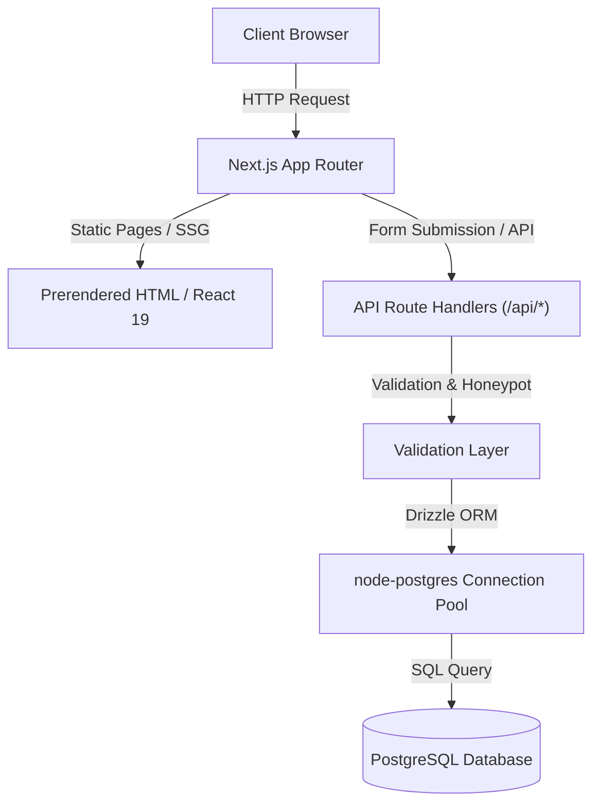

# System Architecture & Technical Specifications

## 1. Technical Stack Overview

| Layer | Technology | Version | Purpose |
| :--- | :--- | :--- | :--- |
| **Framework** | Next.js (App Router) | 16.2.6 | Full-stack React framework with Turbopack compilation |
| **Runtime / UI** | React / React DOM | 19.2.6 | Component tree, Server/Client components |
| **Language** | TypeScript | 5.9.3 | Strict type safety and interface definitions |
| **Styling** | Tailwind CSS v4 | 4.1.17 | Modern CSS variables-based styling engine via `@tailwindcss/postcss` |
| **ORM / Database** | Drizzle ORM / `pg` | 0.45.2 / 8.20.0 | Type-safe PostgreSQL client and schema migration tool |
| **Code Intelligence** | GitNexus | 1.6.x | Zero-server client-side code knowledge graph & AST analyzer |
| **Icons** | Lucide React | 1.16.x | Standardized, tree-shakable SVG icon library |
| **Typography** | Google Fonts (`next/font`) | Next.js built-in | `Fraunces` (Editorial Display) & `Inter` (UI Sans) |

---

## 2. Directory Structure

```text
msitm-website-audit-rebuild/
├── .agent-data/                  # Persistent agent storage (isolated from source)
│   └── code-graph/               # Code graph runtime metadata
├── .agents/                      # Permanent AI agent configuration
│   ├── AGENTS.md                 # Agent standard instructions
│   └── skills/                   # Local agent skills (ponytail, task-chunking, etc.)
├── .gitnexus/                    # GitNexus local knowledge graph and CLI runner
├── docs/                         # Engineering documentation & guidelines
│   └── engineering/              # Central architectural and governance docs
├── public/                       # Static public assets (brand images, icons)
├── src/
│   ├── app/                      # Next.js App Router (pages, layouts, routes)
│   │   ├── [slug]/               # Dynamic legacy article routes
│   │   ├── about/                # Institutional overview & leadership
│   │   ├── admission-form/       # Student admission application interface
│   │   ├── api/                  # Server Route Handlers (REST endpoints)
│   │   │   ├── admission/        # Handles admission form POST
│   │   │   ├── certificate-lookup# Public certificate lookup logger
│   │   │   ├── enquiry/          # Contact/inquiry form POST
│   │   │   ├── feedback/         # Student corner feedback POST
│   │   │   └── health/           # Healthcheck and DB ping
│   │   ├── courses/              # Course catalog (UG, PG, Diploma, Certificate)
│   │   ├── facilities/           # Campus infrastructure (Labs, Library, etc.)
│   │   ├── faculty/              # Academic department faculty directories
│   │   ├── globals.css           # Tailwind v4 theme definitions and utilities
│   │   ├── iqac/                 # Quality assurance committee pages
│   │   ├── layout.tsx            # Root HTML shell, fonts, Header & Footer
│   │   └── placement/            # Placement records and recruiters
│   ├── components/               # Reusable React components
│   │   ├── Header.tsx            # Sticky navigation, mega menu, mobile drawer
│   │   ├── Footer.tsx            # Institutional footer & links
│   │   ├── chrome.tsx            # Section headings, breadcrumbs, banners, callouts
│   │   ├── forms.tsx             # Validated enquiry and admission forms with honeypot
│   │   ├── icons.tsx             # Centralized Lucide icon registry
│   │   └── widgets.tsx           # Recruiter marquees, placement grids, stats
│   ├── data/                     # Content models and static institutional data
│   │   ├── content.ts            # Dynamic page content blocks
│   │   ├── courses.ts            # Course syllabi, fees, durations, criteria
│   │   ├── faculty.ts            # Faculty roster data
│   │   ├── news.ts               # College announcements and events
│   │   ├── search.ts             # Static search index data
│   │   └── site.ts               # Institutional contact, navigation, placements
│   ├── db/                       # Database connection and schema definitions
│   │   ├── index.ts              # PostgreSQL Pool & Drizzle client instance
│   │   └── schema.ts             # Enquiries, admissions, feedback tables
│   └── lib/                      # Shared helper utilities
│       └── utils.ts              # ClassName merge (`cn`) utility
├── components.json               # shadcn registry configuration
├── drizzle.config.json           # Drizzle Kit migration configuration
├── next.config.ts                # Next.js configuration & remote image patterns
├── package.json                  # Project dependencies and npm scripts
└── tsconfig.json                 # TypeScript compiler options & `@/*` path alias
```

---

## 3. Data Flow & Routing Strategy



1. **Static Pre-Rendering (SSG)**: Academic courses, faculty profiles, campus facilities, and news pages are prerendered at build time via `generateStaticParams`, yielding sub-50ms TTFB.
2. **Server Route Handlers**: Interactive submissions (`/api/enquiry`, `/api/admission`, `/api/feedback`) are processed via Next.js Route Handlers with anti-spam honeypot verification and server-side input validation.
3. **Database Access**: All database operations execute through Drizzle ORM with connection pooling managed in `src/db/index.ts`.
4. **Environment Isolation**: Database connection strings are resolved from `process.env.DATABASE_URL` with `.env.example` defining configuration requirements.

