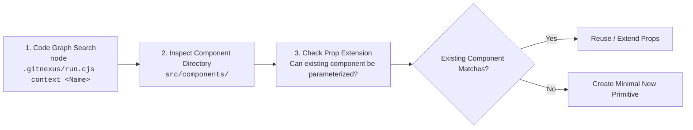

# Component Reuse Directory & Search-First Protocol

This document details the existing component inventory in `src/components/` and enforces the search-first protocol to prevent duplicate component creation (Phase 7 Rule 2).

---

## 1. Search-First Protocol

Before writing any new component, the engineer or AI agent must execute this 3-step check:

---

## 2. Shared Component Inventory

### 2.1 Site Chrome & Layout (`src/components/chrome.tsx`)
- `SectionHeading`: Renders editorial section headers with eyebrow, title, gold divider rule, and optional intro paragraph. Supports `align="left" | "center"` and `light` mode for dark bands.
- `Breadcrumbs`: Accessible breadcrumb trail navigation with semantic `<ol>`, `<nav>`, and aria-current attributes.
- `StatCard`: Standardized metric cards (number + label) for campus statistics and achievements.
- `Banner`: Highlight announcements and alert strips.
- `CalloutBox`: Parchment or navy accented callout boxes for admissions advisories.

### 2.2 Navigation & Structure
- `Header` (`src/components/Header.tsx`): Sticky institutional header, top utility bar (contact details, phone, admissions link), mega-menu explorer, and responsive mobile drawer with keyboard navigation.
- `Footer` (`src/components/Footer.tsx`): Comprehensive institutional footer, accreditation badges (Avadh Univ, Maa Pateshwari Univ, NIELIT, ISO 9001:2015), quick links, and contact details.

### 2.3 Interactive Forms & Security (`src/components/forms.tsx`)
- `EnquiryForm`: Contact and course enquiry submission form with anti-spam honeypot defense, client-side regex validation, and POST handling to `/api/enquiry`.
- `AdmissionForm`: Multi-field student admission application form with qualification level, course selection, and error alerting.
- `FeedbackForm`: Student corner feedback and grievance submission form.
- `Honeypot`: Silent anti-bot honeypot field (`website` param) preventing spam submissions without user-facing CAPTCHAs.
- `FieldError`: Accessible field-level error alert (`role="alert"`).

### 2.4 Data Widgets & Visuals (`src/components/widgets.tsx`)
- `RecruiterMarquee`: Infinite smooth marquee of company recruitment partners with pause-on-hover.
- `PlacedGrid`: Responsive grid of placed students with company tags, photo lazy loading, and expandable count pagination.
- `TestimonialSlider`: Alumni and student testimonial display.

### 2.5 Icons (`src/components/icons.tsx`)
- `Icons`: Single source of truth for Lucide React icons.

---

## 3. Extension Rules

1. **Parameterize Instead of Forking**: If you need a `SectionHeading` with a subtitle or different background, add an optional prop (e.g., `subtitle?: string`) instead of creating `AlternativeSectionHeading.tsx`.
2. **Compound Composition**: Combine `SectionHeading` + `PlacedGrid` inside page containers rather than creating monolithic single-use components.
3. **No Dead Code**: If a component is refactored and no longer referenced, run `node .gitnexus/run.cjs impact <Component> --direction upstream` to verify that no callers exist before deprecating.

